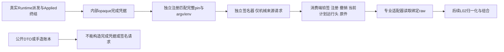

# Guard Authority — EG-K09 实施切片

事实源：CodeGuard `openspec/changes/add-engineering-guard-core/tasks.md` EG-K09、engineering-gate EG-GATE-002/003；本目录不是第二套规格。K10的grant签发/消费、Git写操作及平台部署不在本库。

## 核验设计与不可变边界

本库实现现有 `ApprovalAuthority`、`MigrationAuthority` 的密码学核验提供者。receipt来源、信任锚、撤销源与时钟必须由受保护宿主注入；候选JSON、CLI actor、工作区配置或OPA ALLOW不能创建该配置。端口实际部署隔离不由本库证明。

冻结签名profile：`b"guard.approval-receipt/v1\n"` 后拼接receipt JSON的RFC8785/JCS字节。仅删除 `proof.signature`，其余字段包括documentType/schemaVersion、algorithm/keyId/provenanceDigest和extensions均受签名保护。Ed25519签名采用公共协议标准base64，不能读legacy hex evidence envelope替代。

附属闭合 `guard.approval-material/v1` 将audience、repository/task、requester、action、purpose及完整ApprovedScope绑定到 `proof.provenanceDigest`；scopeDigest为精确scope JCS摘要。purpose为layer(level)、task或migration(requestDigest)。不借用extensions承载授权语义，不更改旧公共wire。scope仅排序后的精确actions与TargetSelection集合，不实现glob、字符串前缀、Unicode归一化或路径摘要身份。未知语义拒绝。

RequirementScope无subject，范围、契约与其他批准内容不变可复用；CandidateAcceptance/OperationAuthorization必须精确subject。本profile的layer/task/migration批准要求批准principal与session.requester不同且principal/role获得独立anchor授权；这是编码请求者与批准者分离的profile，不是对所有用户授权形式的通用推论。

验证结果使用私有字段、不实现Deserialize。每次消费重新读取四个端口并核验有效时间/撤销/issuer/key/role/audience；不把token永久缓存成批准。撤销快照必须来自独立当前权威；版本回退在当前verifier实例内拒绝（同revision不同stateDigest/记录同样拒绝），跨重启抗回退由受保护source维护，普通本地SQLite不提供该权威。

## 批准核验切片的本地验收行为

- 真实Ed25519签名RED→GREEN，字段篡改/错actor/role/audience/过期/未来/撤销/撤销源故障/版本回退拒绝。
- 坏版本、重复key、未知材料字段、错误base64、签名域混用拒绝；原scope扩大或候选kind错配拒绝。
- 真实契约编译先blocked→独立批准→ready，不在读取端自动签名；三个layer及最终编译digest逐一核验。
- 真实Git输入+SQLite头迁移，无批准失败，独立签名批准后CAS成功；旧头/改request失败。
- 两个不同候选复用同scope批准，旧候选技术结果不等价；不输出grant、ALLOW或生产隔离证明。

未实现/未运行项不能凭README标为完成；CI/正式任务账本由主任务单独维护。

## 当前接口与实施范围

- `ApprovalVerifier::verify`：从四个独立端口重读原件、anchor、时钟与撤销快照，严格验签；`revalidate`在消费旧opaque对象时重读全部端口。结果不实现Deserialize。
- `ReceiptApprovalAuthority::for_compile`直接读取实际三层CompileRequest，严格解码ContractSnapshot、重算层摘要并提取所有义务目标的去重全集；不能用调用者自报较小scope包装实际大契约。普通业务输入摘要不进入RequirementScope，protectedDigest仍进入批准范围。
- 角色授权精确到principal/role/intent/purpose（组织层、项目层、任务层、任务授权、迁移分别限制）；所有本profile批准均要求principal不同于受保护session.requester。
- 缺最终编译digest的批准时，真实编译保持blocked；独立批准端可通过现有只读权威请求记录精确digest，批准后重试。检索端不签名，不在缺收据时自动问用户或自动授信。
- 迁移材料绑定实际MigrationRequest.digest，其中含旧head revision和完整新旧binding；CAS前guard-plan再次核验同请求及同authority/ref/digest。初次批准审计原件可留存，即使末次核验失败没有发布head；审计存在不代表迁移完成。

CAS前核验只证明该边界再次观察到有效批准，不与外部撤销服务形成原子事务。真正动作消费须K10复验/幂等对账；CompiledContract及RegisteredPlan的clone也不是永久批准。anchors/receipt/revocation/clock端口均需受保护宿主注入；本库不验证真实宿主隔离或真实人机批准通道。

已发布批次实现K09的批准核验切片。生产者身份/来源核验的新增本地候选见下节；GuardResult到Flow verifiedResultIds的受信normalizer、实际受保护CI/宿主安装、grant签发与消费仍未实现；来源切片仍须真实完整回归及新双OS CI后再判断EG-K09实现任务验收，不能升级现有UNVERIFIED结果。没有增加Flow策略或扩大K08。

## 撤销条目精确身份与不可复活

`RevocationSource::current`显式接收issuer/keyId/receiptId/revocationRef，返回snapshot必须重复绑定相同tuple。共享撤销名单使用authority+issuer+key的单调revision/stateDigest；逐receipt记录包含完整tuple，避免同一名单版本下多个正常收据互相误判equivocation。

实例内已观察撤销的issuer/receiptId永久拒绝，即使更高revision改回active或切换名单引用也不能复活；重新批准需新receiptId，换key也不能沿用旧receiptId。这个sticky集合不声称阻止从未观察过的被撤销key的其他receipt复活，密钥永久撤销、跨重启高水位与不可复活仍由受保护source提供。不把测试内存源或本地SQLite当成生产权威。

验签使用严格原始wire构造JCS payload；只删除proof.signature。不能先typed反序列化再重序列化来验签，否则skip_none可能吞掉攻击者新增的未签null字段。接收入口同时执行已冻结protocol的真实闭合JSON Schema，保留该null攻击负例。

旧opaque对象的 `revalidate` 不仅重新验签/撤销/时间，也要求完整receipt身份与内容保持一致，不能静默替换签发者、批准人、角色、密钥或期限。独立许可的新批准仍应使用新receiptId。

同一verifier实例首次成功核验后，按issuer+receiptId冻结完整原始wire的JCS摘要（含signature和全部proof字段）。再次读取另一份有效签名原件也会拒绝，并永久隔离该逻辑ID；恢复旧原件不能撤销已观察冲突。普通verify和实际批准适配器共用此约束，重新批准必须新receiptId。跨重启原件不可变登记仍由受保护source保证，本地实例缓存不等于生产权威存储。

## 已执行验证（不等同完整K09验收）

Rust 1.85、Windows、锁定依赖离线串行执行：7项真实Git/SQLite集成测试通过（102.08秒），14项真实Ed25519签名与边界测试通过（0.69秒），1项禁止反序列化授信对象的compile-fail文档测试通过（1.17秒），共22项。严格Clippy `--all-targets --no-deps -- -D warnings`、fmt检查通过。

新增同ID原件替换测试先真实失败（22.26秒）：迁移首验后，将原件替换为同issuer/ref/request/contract、另一独立许可批准人的有效签名，原实现仍发布head。修复后真实适配器二验拒绝，原SQLite head保持有效。签名固定域另由独立组装payload与独立ring签名器验证；不是仅生产者和核验器共用同一辅助函数。

现有guard-plan原12项真实规划回归也已执行通过（204.42秒）；本批仅在迁移发布CAS前增加当前binding检查与第二次同请求批准核验，不改变正常规划范围。测试内受控端口不证明生产信任部署，K09任务保持未完成。

作者最终停写后，同级审查者独立运行最终verification测试程序，14/14通过（0.78秒），零跳过；只读安全审查未发现新增确证阻断。本次独立复验未重跑7项Git/SQLite或Linux。该批准切片随后已于afa1082发布，实际CI 38992692068为21/21 job成功（含Windows/Ubuntu）；文档快照58b8b69的CI 38993606579也21/21成功。这些已发布结果不涵盖下面尚未提交的来源切片。

## K09来源切片（新本地候选，尚未发布）

沿用EG-GATE-002、EVI-002/003/005，不建立第二规格、不改旧协议。`ProducerVerifier`只核验机械来源；不接任意GuardResult，不签assessment，不输出Flow verified arrays或执行grant。旧报告中的local_unverified/not_evaluated原样保留，独立来源对象不能自动赋予SATISFIED/COMPLETE。

Runtime新增`execute_with_receipt`/`execute_v2_with_receipt`，旧execute档位不执行新凭据读取。`DispatchCompletion`仅由真实ProcessRunner返回实际进程创建信号、账本finalize Applied的路径内部构造；不支持Deserialize/公开new，也没有from_store/from_dto。OS创建信号不证明Windows进程已Resume或用户程序完成，真实执行状态/起止观察仍原样保留。辅助凭据采集失败返回None及受限qualification_error，原观察保持；Existing、未创建进程和AuditOnly没有凭据。

`ProducerVerifier::prepare`只接opaque完成凭据，受保护ProducerRegistry还要独立匹配repo/task/contract/policy/scope、完整ProducerIdentity、全verifier pin摘要、domain、候选种类、profile、批准argv与环境，并核对本次有效调用。不能从候选CompiledContract或报告自称批准推导注册。`ProducerSigningRequest`私有字段且不可反序列化；Signer端口仅接该机械请求，库不持有生产私钥。

新附属闭合`guard.producer-attestation/v1`采用独立域`b"guard.producer-attestation/v1\n"`与原始wire RFC8785/JCS，仅删除proof.signature；issuer/audience/algorithm/keyId/provenance和全部机械字段均签入。Ed25519 strict拒弱key，标准base64不混legacy hex。签名原件与argv/env可能敏感，按私有证据保管，不自动写公开摘要。

`verify_live`先验独立来源签名再比对真实opaque凭据并重核当前原件；`verify_restored`跨重启必须验独立签名及当前RegisteredPlan、完整plan/run head（含revision）、序号、operation、六身份、pin、metadata/双流实际摘要尺寸和保留期，前后重新查注册/撤销/时钟。恢复只产生来源核验对象，绝不恢复DispatchCompletion。签名曾有效、旧metadata存在或本地PASS都不能绕过当前头。签名检查与外部撤销及未来操作不是全局原子事务。

生产者签名同样按issuer+attestationId冻结完整原始wire摘要；有效重签另一份原件会隔离该ID，恢复旧字节不能消除冲突。已观察撤销不能通过更高active版本或换key复活旧ID。实例缓存不能提供跨重启权威；持久不可变ID及撤销抗回退依赖独立受保护端口。

`max_validity_ms`只限制attestation的issuedAt→expiresAt，不是来源运行TTL。仍current且原件保留的等价运行可新签；startedAt/finishedAt/sequence不刷新，新签不等于重跑。没有擅自增加全局max_source_age，也尚未核验漏洞库等外部数据TTL；需要时由专业/组织profile显式批准并检查。

安全边界是安全Rust API与明确受保护端口；不证明恶意同进程宿主、私钥失陷或同OS写者隔离。当前本地候选仍待完整回归和新双OS CI，EG-K09暂不关闭。真实生产部署、L02的Flow受信组合及K10继续由各自后续任务负责，不反向扩成EG-K09实现任务的前置。

此来源profile只覆盖Runtime执行的domain verifier（编译pin具有专业owner）。policy-engine的owner=None不产生完成凭据；OPA继续由独立BoundPolicyEvaluator执行和核验，本批不重构K08，也不声称建成所有生产者/角色的统一签名体系。其他provider不能借本profile的opaque类型自行授信。

## 来源候选的实际验证证据（Windows，Rust 1.85）

最终同源码串行、锁定依赖离线回归：Authority 7项真实契约/Git/SQLite集成通过（97.01秒），1项真实Runtime/独立来源签名组合E2E通过（62.57秒），15项真实签名与边界通过（0.70秒，含OperationAuthorization合法subject/换subject/错action），3项compile-fail文档测试通过（0.64秒），共26 reported测试，零ignored。Runtime完整4项unit+14项E2E+2项compile-fail全通过（E2E 575.70秒）；Ledger原10项reported通过（3.95秒，含1个worker辅助入口）。三crate的all-features/all-targets严格Clippy、fmt检查和diff检查通过。

来源组合E2E的首次真实RED为54.56秒：同次真实失败进程和独立签名存在，但目标核验尚不可用；修复后的扩展组合曾通过127.02秒，根独立运行最新版通过64.26秒，最终完整套件再次通过62.57秒。一次测试撤销端口重复临时锁导致夹具自锁，核对唯一测试进程身份后停止；该轮非正常退出不计通过。Runtime凭据首个真实RED为20.06秒，后续手造active metadata与Existing提前终结负例均已纳入最终14项E2E。

组合E2E内的多个断言不单算独立测试。旧头/撤销/过期负例检查精确目标错误，避免被其他损坏原因掩盖。源profile仍是未发布本地候选，新双OS CI由主任务执行，不沿用已发布批准切片的旧绿作为新源码证据。
