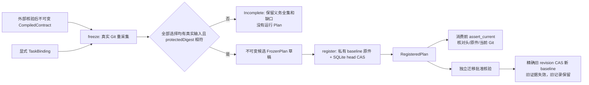

# GuardPlan：批准基线、候选计划与显式迁移

EG-K03 的独立库基础。输入是 `guard-contract::CompiledContract`、显式 `TaskBinding` 和 `guard-subject::CapturedSubject`；持久化使用 `guard-store` 的私有原件及 SQLite active-head CAS。本库不签发授权、不执行验证器、不产生工程通过，不把本地文件提升为可信生产者。EG-K03原任务范围已通过真实Git/SQLite、必要反例和独立审查，见[验收证据](../../docs/delivery/EG-K03-evidence.md)。产品CLI、受管runner与真实独立授权服务仍由后续任务接入，不能据局部任务完成宣称P0可交付。



## 契约与候选不能混用

契约中的 `ContractObligation`/`TargetSelection` 固定仓库、路径、selector 和可选 `protectedDigest`。没有保护摘要的普通源码可以在既有批准范围内变化；每个新候选从实际 Git 清单绑定新的 `ExactTarget.inputDigest`，生成不同 `VerificationPlan`，不要求重新批准同一个契约或重复申请同范围授权。

目标缺失或 protectedDigest 不相符时，`PlanningOutcome` 保留全部批准义务和逐项 `TargetIssue`，状态为 Incomplete，`plan()` 为 None。不创建删除缺模块后的局部“成功”计划。selector 仅作为固定选择身份传递，本库不宣称已完成 Java 符号/语义分析。

`freeze` 接收的 CapturedSubject 虽然是公开交换结构，但会通过真实 Git `verify_current` 重新采集逐字段比较，拒绝伪造清单、过期候选、错误 worktree/任务/契约/工具 pin。全部编译规则、义务、来源、批准引用、验证器/OPA pin、Schema 摘要、TaskBinding、捕获输入、预算均进入不可变快照；没有工具结果参数，不按返回结果倒推义务。

当前档位是单仓库、明确文件选择的计划。TaskBinding 的仓库/动作/路径和批准来源必须与编译产物一致，不能在绑定阶段扩大或缩小。跨仓库选择需要分别捕获和编排，不会猜测另一个仓库的文件摘要。

## active 绑定与恢复

`PlanningOutcome` 和 `FrozenPlan` 都不提供 Deserialize。`freeze` 只生成草稿；解析一份 VerificationPlan JSON、调用 `load` 或复制其字段，不会产生 `RegisteredPlan`。

`PlanningOutcome::register` 先重核当前 Git，再以 `repo/task` 为稳定 head key 注册批准 baseline。session/worktree 归属在 baseline 内容中，不进入可另建空头的 key；自报新 session/worktree 不能把同一任务绑定到另一个契约。baseline 原件只含不可变编译批准快照与 TaskBinding，不含普通候选字节，因此正常代码迭代沿用同一个 baseline/head。

初始注册用 `None -> complete baseline` CAS；已有头只能逐字复用同一 baseline。另一个新契约即使已经单独编译批准，也不能通过 register 覆盖旧任务。并发初始绑定仅一个获胜；失败者不能移动头。

`persist` 保存完整准备快照作为私有原件。`load` 必须提供不可变编译产物和当前真实候选重新构造，并与原件规范字节完全比较，它只恢复草稿。`restore_current` 还必须核验现有 active 头、原件完整性/保留期和 baseline；不能用旧快照重新注册或复活已迁移头。

消费 RegisteredPlan 前调用 `assert_current(store, project, now_ms)`，检查完整 head identity（含 revision）、私有原件及当前 Git。它只证明当前绑定和输入一致，不证明某份外部测试报告已通过，也不替代 K09/K10 的独立授权与最终执行时对象条件检查。

## 显式迁移

`migrate` 只接受 RegisteredPlan 和显式注入的 `MigrationAuthority`，要求新 CompiledContract 与真实捕获重新准备完整。请求摘要绑定旧/新完整快照、TaskBinding 和精确旧 head revision；端口必须独立核验来源、范围、期限、撤销以及需要时的新 session/worktree 归属。缺端口、拒绝、错摘要或跨 task/repository 迁移均拒绝。允许的范围/归属迁移不能靠候选文字自批。

新 baseline 原件与迁移批准引用先私有持久化，最后用旧 head identity CAS；批准期间有竞争更新就拒绝，不覆盖别人的头。进程中断或 CAS 失败可留下非 active 的完整原件供审计，不能因为原件存在就自动接受迁移。旧计划/批准/结果不删除；不等价计划的旧结果必须重验，`previous_evidence_requires_revalidation` 明确给出身份失效。旧 RegisteredPlan 及 restore_current 在迁移后都无法继续作为当前绑定。

## 信任与阶段边界

- 当前准备器只消费真实 Git 捕获；协议已能表达 release_artifact，但将其 JSON 嵌入 CapturedSubject 会明确拒绝。本库没有发布制品采集或制品计划提供器。
- 生产必须由受保护控制端配置唯一 GuardStore/registry，并限制通用存储 CAS 的访问；调用方不能允许候选选择另一个空数据库当作同一注册表。本库没有完成跨数据库身份、反回滚或远程租户认证。拥有同用户存储写权限的代码仍可改写本地状态，不能声称 OS 隔离。
- ApprovalAuthority/MigrationAuthority 必须由控制端注入。本库没有默认批准端口，不从 JSON 选择核验者；测试用 fixture 端口只证明接口绑定，不能替代 K09 的真实签名、角色、时效和撤销验收。
- 验证器 pin 与编译产物匹配；CapturedSubject 的 policy/environment digest 在本库中是冻结的显式声明，会进入候选/计划身份。真实政策包内容和真实工具链环境由 K08/K06 核验，重采集 Git 本身不证明这两个声明真实。
- Action 和候选 kind 均冻结；计划不是合入许可。K10/GitGuard 仍需按实际动作检查最终 merge candidate、目标 ref 和授权 audience/期限/撤销，不能把局部 worktree 计划重新贴成合入通过。
- 此版本没有把每个计划接入受信运行序列、真实审批服务或执行隔离，未宣称整体 P0/enforced 模式完成。这里的 Ready 是草稿准备状态，不是授权。

## 验证

```powershell
cargo +1.85 test --locked --offline
cargo +1.85 clippy --locked --offline --all-targets -- -D warnings
cargo +1.85 fmt --check
```

真实临时 Git 与 SQLite 例覆盖：批准旧规则不被候选修改替换、缺目标保留全集、无保护源码更新沿用批准并刷新计划、保护摘要变更阻断、伪造/旧捕获、错误工具 pin、JSON 重包装/预算变化、私有原件重构、初始 head 竞争、迁移批准拒绝/错摘要、批准期间 head 竞争、迁移后旧头/恢复失效，以及自报新 session/worktree 绕迁移拒绝。

初始 RED 是公共 API 缺失的编译失败。独立审查发现 worktreeId 作为 key 可另建任务头后，新增真实 Git/SQLite 反例在旧实现失败，再把 key 稳定为 repo/task 后通过；不把纯 JSON 或窄 fixture 声称为远程授权、托管保护、跨平台或整套架构完成证据。
