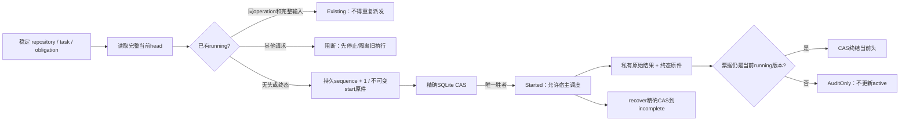

# Guard Run Ledger：本地持久化运行顺序

此独立候选库提供EG-K06/EVI-003的一部分：运行start/finalize/recover、单飞、持久运行序号和迟到结果处理。沿用CodeGuard的`add-engineering-guard-core`、`engineering-evidence/spec.md`、protocol与design D07为事实源。它复用guard-store现有SQLite、私有原件和完整head CAS，不增加内存事实源、不修改旧.codeguard、不执行工具或Git动作。没有勾选K06，也不代表完整D07表族或P0交付完成。



## API与身份

- `RunLedger::new(&EvidenceStore)`使用控制端配置的唯一私有registry，不创建存储或发现项目。
- `RunScope`包含repository_id、task_id、obligation_id、approved_scope_digest。稳定key仅取前三者；批准scope摘要在首次状态内固定，后续改变会阻断。本包尚无scope迁移端口。调用方应从K03已冻结义务选择准确ID，不能让候选另编task/obligation或另选空数据库冒充同一任务。
- `RunIdentity`分别固定binding、subject、contract、policy、verifier和environment六个摘要。approved_scope_digest不等于binding_digest；普通候选绑定可变化，而批准范围保持不变。kind/action/worktree/session及义务全集应已包含在对应K03绑定和subject摘要中，本库不从自报字段独立证明其真实性。
- `start(scope, identity, operation_id, retain_until_ms, now_ms)`返回`Started(ticket)`或`Existing(ticket)`。只有Started允许新调度，Existing是同一running请求重试；其他running请求阻断。同一operation不能复用于后续轮次。CAS落败不允许派发，也可能留下完整但非active的意图；不得凭该原件自动启动。禁止客户端自报run sequence，持久旧序号checked_add溢出时阻断。
- `RunTicket`字段私有、无Deserialize；`sequence()`仅返回存储分配值。票据是本地并发令牌，不能当授权或跨registry证明。
- `finalize(ticket, state, raw_result, now_ms)`先保存原始字节与完整lineage，再以精确旧head令牌CAS。Pass/Fail/Incomplete/Cancelled/Timeout/Error均为本地状态。重复完全相同终结返回Unchanged；不同终结或已过期运行返回AuditOnly，不更新active。保存原件或检查失败则返回错误，不报告成功。迟到结果的私有终态原件和store事件保留，但原件存在本身不产生当前资格。
- `inspect(scope, expected_identity, now_ms)`只有全部六个身份相同才给出当前状态；任一不同显示Stale且不暴露可复用result_digest。即便输入从a变b又回a，唯一头仍是最新轮次，旧ticket不能恢复旧PASS。公开观察固定`trust: local_unverified`。
- `recover(scope, now_ms)`将所见running精确CAS为Incomplete；没有PID记录、进程存在探测、重放或kill。它可以立即撤销资格，但不证明OS进程死亡。恢复调度前，受保护宿主必须另行停止/隔离旧执行树。WindowsJob/Unix进程组、取消、超时与输出预算由guard-runner承担；跨宿主中止与平台证据仍属后续K19等任务。

## 持久化与失败边界

每次完整状态以`guard.run-record/v1`闭合结构保存在私有artifact，active头使用guard-store的跨进程SQLite事务和完整revision CAS。启动意图、结果及终态分别先持久化，事务不跨长工具运行；崩溃可能留下非active完整原件，不能据此恢复PASS。running头被恢复为incomplete后，旧票即使仍在某进程内也不能终结当前头。

读取均复核head与引用的原始结果完整性、状态及保留期。丢失、损坏、pending、quarantined或expired不能恢复active；store观察到损坏后持久隔离，恢复相同字节也不能复活。本库不清空坏头重新从1计数；需要受控外部恢复。保留期限、配额和busy界限使用既有store约束；时钟是调用方提供值，既不分配运行顺序也不证明可信时间。

结果单件先限制4MiB，再受store更小配额约束。公开对象只给序号、固定状态、摘要和local_unverified标签；自由文本只在私有原件。私有raw_result不作语义解析，调用方自报Pass不等于真实测试通过。没有签名/远程身份/K09授权，也没有防恶意同用户修改或跨数据库回滚能力。store需受保护唯一控制；候选不能直接调用通用CAS覆盖头。

原始结果始终按二进制文件保存；操作名只对其 SHA256 和固定运行元数据做规范化，不将字节转成 JSON 数组。独立审查的 16KiB 原件真实反例最初被协议数组预算误拒，修复后 16KiB 与完整 4MiB 非 UTF-8 原件均可落盘并复核摘要，仍不放宽协议本身的数组/文档预算。

## 实际验证

最终独立回归为10个reported测试全部通过，其中1个为实际子进程worker入口；fmt与严格Clippy通过。此计数包含新增的大二进制原件回归，不把worker单独算产品行为场景。

Rust1.85，独立E盘Cargo缓存、TEMP/TMP、target及本目录Cargo.lock。首次先写真实双进程start竞争、旧PASS不能覆盖新FAIL、子进程直接退出后恢复测试，实际RED为公共API缺失的编译错误；实现后这些实际SQLite/文件/子进程行为通过。未声称初次编译RED是已观察到某个旧运行算法的行为失败。

`tests/ordering.rs`另外覆盖六个身份维度、scope改变拒绝、同operation幂等不重复派发、不同running阻断、恢复后旧ticket拒绝、重开后序号递增、取消不被PASS改写、到期不重建、原件损坏持久隔离。worker仅为子进程辅助入口，不单独算产品验收场景。当前运行平台为Windows，不将其推断为Unix或断电验收。

```powershell
cargo +1.85 test --locked --offline --manifest-path crates/guard-run-ledger/Cargo.toml
cargo +1.85 fmt --manifest-path crates/guard-run-ledger/Cargo.toml -- --check
cargo +1.85 clippy --locked --offline --manifest-path crates/guard-run-ledger/Cargo.toml --all-targets -- -D warnings
```
