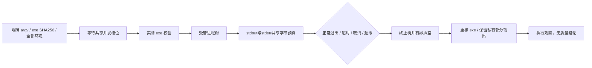

# GuardRunner：有界本地验证器执行

本独立库承担EG-K06的进程执行部分。输入是受保护宿主明确选择的原生可执行文件、SHA256 pin、argv、工作目录和全部环境；输出仅为执行维度与有界私有原始字节。退出0不产生规则PASS、完整覆盖、可信生产者或交付授权。运行序列、原件与迟到结果裁决由相邻guard-run-ledger提供，guard-runtime已接通真实候选执行；EG-K06的本地机械范围见[验收证据](../../docs/delivery/EG-K06-evidence.md)。产品CLI、受信控制器和完整平台矩阵仍由各自任务承担。



## 执行语义

`ProcessRunner::new(ExecutionBudget)` 固定时间、总输出和并发预算。同一实例及其 clone 共享 Tokio semaphore；同一冻结计划应由控制端复用同一实例，不能每项义务重建独立预算。时间预算包含并发排队、执行前 pin 校验及运行；清理中的 Windows Job 清空确认、父进程等待、管道排空及结束 pin 复核各另有最多 2 秒等待。原生阻塞文件哈希无法被 Rust future 强行取消；后台哈希仍持有并发令牌，不会因取消释放令牌而无限堆积读取任务。OS 本身挂起的文件系统调用不受异步超时强行中断。

`run_until(CommandSpec, Cancellation, std::time::Instant)` 接受宿主冻结的绝对单调截止时间，实际截止为调用方时刻和本次调用开始加自身固定 timeout 的较早者。上层运行时可以在排队之前冻结截止，经过自己的队列后仍传入同一时刻，避免排队和进程执行各获得一份新预算。`run` 的原有语义不变，两个入口共享私有执行过程、同一 semaphore、输出保留与清理。已过期的截止直接返回 TimedOut 且无 PID；完成执行前 pin 校验后再检查，过期不得启动进程。较远的调用方截止不能延长执行器自身预算。执行停止由内部截止分支处理，不用外部 timeout 丢弃整个 future，因此仍可排空并保留部分原始字节；既有有界清理等待独立保留。

`run(CommandSpec, Cancellation)` 不经过 shell，不从工具报告抽取命令，不继承宿主环境，stdin 为 null。Windows 仅接受原生 `.exe`，不会隐式运行 `.cmd`/`.bat`。args、环境条数和总字节数有上限；可执行文件为最多 512 MiB 的普通文件，拒绝路径上的 symlink/reparse。调用前与结束后实际 SHA256 核对；结束无法复核仍保留已收集输出，返回失败维度。

stdout/stderr 使用各自异步读取器、8 槽有界通道和共享保留预算。任一流超过总预算即终止树，保留原始前缀和 `output_truncated`；两流之间没有承诺全局字符顺序。正常退出后也排空缓冲，发现超限仍改为失败。超时、取消及非零退出不丢弃已经观察到的字节，专业适配器应继续保留其中可证明的违规并报告部分覆盖。原始字节可能含敏感信息，不能直接作为公开摘要。

`Cancellation` 单向生效，不可复位。排队取消没有 PID；运行取消、超时、输出超限或调用 future 被丢弃都清理该次受管树。正常父进程退出也终止遗留子孙，避免持有管道的孙进程无限阻塞。

`started_at` 记录实际创建进程后的 UTC 墙钟观察，`finished_at` 记录受管树停止和管道排空后的 UTC 观察；未派发时均为 None。墙钟由本机提供，不参与运行先后裁决，不构成可信批准时间。时钟无法表达或倒退时保留原始观察并标记 `ClockInvalid/Failed`，不将结束时间钳成开始时间，也不靠解析旧报告时的当前时间补造运行记录。UTC 格式化使用固定 Chrono 0.4.42 的 std-only 功能，不引入时区数据库；日历越界/闰日和真实进程前后时间均有测试。

## 平台与信任边界

Windows 使用 `CREATE_SUSPENDED | CREATE_NO_WINDOW` 创建进程，先加入未开放 breakaway 的 Job，再恢复唯一暂停线程；不存在先运行候选代码后才尝试接管的窗口。Job 设置 `KILL_ON_JOB_CLOSE`，控制进程意外死亡也会关闭句柄并终止子孙。接管或恢复失败明确报错，不能回退为只杀父进程。恢复前的线程快照枚举最多 65536 行、5 秒，枚举异常明确失败，不以部分清单恢复线程；原1秒墙钟上限在默认并发回归中真实触发假失败，调整至5秒仍保留数量与时间硬界，不依靠减少测试并发。Job接管之后及恢复主线程之前都核对同一运行绝对截止；耗尽预算时保持暂停并进入统一超时清理，不能把枚举时间当作额外执行预算。当前 Windows 的真实多进程测试验证了这条路径。

正常等待 `run` 返回时，Windows 在 `TerminateJobObject` 后进一步查询真实 `JobObjectBasicAccountingInformation.ActiveProcesses`，每 5ms 检查，最多等待 2 秒直到为零。查询失败或确认超时保留此前的私有输出，执行维度改为 Failed，不将发出终止等同已经全部退出。随后仍等待父进程和排空管道。调用 future 被强制丢弃或控制进程骤死时无法执行异步确认，只依赖 Job 关闭终止保证，不能声称这两条异常路径在丢弃瞬间完成所有内核清理。Windows API 的终止为异步语义，参考 [TerminateJobObject](https://learn.microsoft.com/en-us/windows/win32/api/jobapi2/nf-jobapi2-terminatejobobject) 与 [TerminateProcess](https://learn.microsoft.com/en-us/windows/win32/api/processthreadsapi/nf-processthreadsapi-terminateprocess)。

Unix 使用独立 process group 并向整个组发送 SIGKILL。它适用于协作式工具链；恶意候选调用 setsid、逃离进程组或宿主遭 SIGKILL 的隔离保证尚未实现，后续必须由受限容器/cgroup/平台控制端补齐。Unix 分支尚未在当前 Windows 本机执行；新增 CI 是待执行验证，不能当作已通过证据。任何平台的进程树管理都不等于 OS 文件/网络/凭据沙箱。

可执行文件前后摘要不是内核级“执行同一 inode”的证明，不能排除有权限修改文件者的 ABA；工作目录及显式环境由受保护控制端配置。候选不能获得控制端密钥或写凭据；本库本身不验证配置者的真实身份，不安装工具，也不签发 grant。CLI、真实领域适配、环境/策略真实性、受信运行序列和最终动作授权保留各自任务。

## 本地验证

已用 Rust 1.85 实际执行 Windows 测试：18 个 reported 测试全部通过，其中 2 个是子进程辅助入口。16 个行为测试涵盖 UTC 观察与日历边界、双流输出、字面 argv、清空 PATH/宿主环境、pin 不符拒绝、非零退出、预取消、超时/取消保留输出、聚合输出截断、共享并发排队、future 中止、正常父退出后子孙终止、控制进程真实强制退出后 Job 清理。测试用原生 fixture 故意遗留子孙，断言心跳文件确实停止变化，未在 fixture 内代替 runner 清理。

新增真实五进程用例包含父、两个直接子、分支进程和孙进程。测试在它们存活时保留原始进程句柄，覆盖正常退出、取消、超时及聚合输出超限；`run` 返回后的第一项观察就以零等待确认每个句柄已 signaled，不先 sleep，也不按可能重用的 PID 重新打开句柄。原有延迟后心跳断言只说明后续活动停止，不单独冒认为返回前停止。另用真实无查询权限 Job 句柄验证查询错误不能解释为空 Job，并让真实存活 Job 触发两秒确认超时，再终止后确认归零。

旧实现首次运行新增五进程断言也通过，未稳定复现返回后继续执行，本次 Job 清空确认是基于明确异步 API 语义的主动增强，不声称该项经历了稳定行为 RED。原有 API 缺失及日志时序测试的历史证据与此项区分。

新增绝对截止接口先实际观察缺少 run_until 的编译 RED，再实现共享执行过程。真实原生 sleep fixture 在早于30秒预算的3秒绝对截止返回 TimedOut 且保留已打印 finding；过期 touch 请求无 PID、没有创建标记；另以真实暂停原生进程核验过期attach返回未恢复、用户代码标记未写入，随后Job终止确认；30秒外部截止不能延长自身2秒预算。

先运行测试观察到公共 API 缺失的编译失败，再实现执行器并通过真实进程测试；并发资源审查进一步使阻塞哈希线程持有 owned permit。fmt 与严格 Clippy 已通过。后续代码或依赖变化必须重新执行受影响检查。

```powershell
cargo +1.85 test --locked --manifest-path crates/guard-runner/Cargo.toml --features test-fixture
cargo +1.85 clippy --locked --manifest-path crates/guard-runner/Cargo.toml --features test-fixture --all-targets -- -D warnings
cargo +1.85 fmt --manifest-path crates/guard-runner/Cargo.toml -- --check
```

实际依赖固定 Tokio 1.53.1（其本地 Cargo manifest 标注 MSRV 1.71、MIT）及 windows-sys 0.61.2，提交本包 Cargo.lock；本包自身已实际用 1.85 编译与运行，不从依赖声明推断本包兼容。
