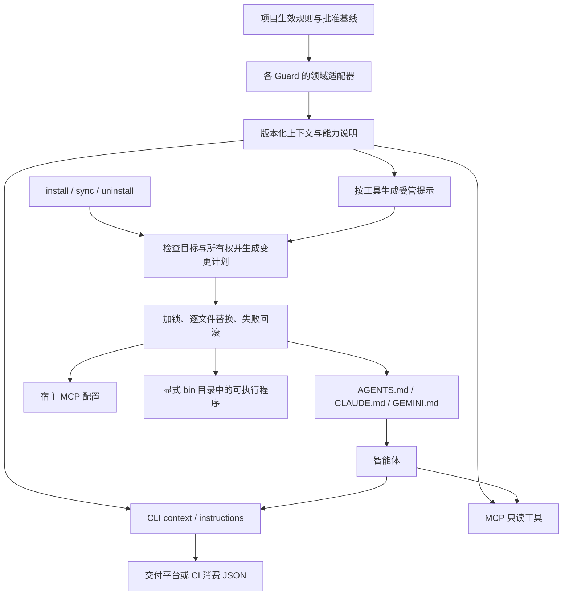
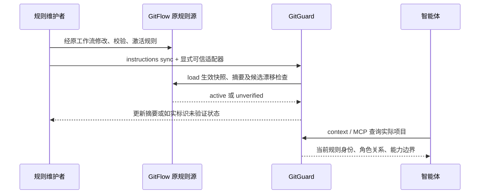

# 六个 Guard 的智能体接入

本次实现把安装、提示同步和只读 MCP 收敛到 `crates/guard-install`。各工具保留自己的领域边界，描述符决定提示内容；领域规则仍由原有规则加载器负责。交付平台负责呈现、审批和编排，CLI 负责本地调用，MCP 负责智能体发现与查询，插件负责技能和任务指引。

规格事实源：`openspec/changes/add-guard-agent-installation/`。本文件是使用说明，不建立第二套规格。



## 已实现边界

| 工具 | 注入提示关注点 | 当前专业能力 |
|---|---|---|
| ArchGuard | 按当前默认契约生成摘要，修改后复检，不放宽边界 | Maven/Cargo 声明图、五类约束、check/explain/verify 专业 CLI 与 MCP |
| CodeGuard | 采用项目原生检查器，按真实结果修复并复检 | 默认完整构建保留原命令；仅接入构建不含检查器 |
| FlowGuard | 阶段前置条件、交接证据、审批与现有文档位置 | 独立 CLI 仅接入；既有专业流程在 flowguard-plugin |
| GitGuard | 按当前激活工作流约束分支、提交、合并 | 通过 gitflow-plugin 原加载器读取规则；不执行 Git 写操作 |
| SpecGuard | 唯一规格事实源、批准基线、需求变更评审 | 独立 CLI 仅接入；尚无专业规格检查 |
| TestGuard | 测试义务、真实执行结果、跳过和未覆盖项 | 独立 CLI 仅接入；尚无专业测试执行与证据门禁 |

当前不会从普通文字中猜测已经批准的规则。没有可用领域适配器时，context 明确返回 `not_evaluated` 或 `unconfigured`。后续专业适配器应读取其正式事实源，并同时服务 CLI、MCP 和提示渲染。提示本身是工作指引；强制约束需要确定性检查、CI 门禁和受控执行器。

现有 YAML 契约与 GitFlow JSON 继续保留。XML 可以成为平台导入格式，但本次没有新增 XML 规则源或解析器；避免同一条规则在 YAML、JSON、XML 和提示中分别维护。

## 构建与命令行安装

六个仓库与 guardengine 放在同一父目录。共享 crate 暂未发布为独立版本，使用相邻源码依赖，不能单独复制某个仓库后宣称可构建。

```text
repositories/
  guardengine/crates/guard-install/
  archguard/
  codeguard/
  flowguard/
  gitguard/
  specguard/
  testguard/
  gitflow-plugin/                 # GitGuard 动态规则适配时需要
```

在对应仓库运行 `cargo build --release --locked`。CodeGuard 完整构建使用 `cargo build --release --locked -p codeguard-cli`，受其既有平台限制。Windows 当前可验证的是 `cargo build --release --locked -p codeguard-cli --no-default-features`：输出仍为 codeguard，但帮助、版本与提示明确标记“仅智能体接入”；专业命令返回不可用，不冒充完整版本。

下面以 PowerShell 为例；把项目路径和构建目录换成实际值。示例说明接口，不会在阅读文档时执行安装。

```powershell
# 先预览：不生成目录、提示、配置、安装记录或二进制。
.\target\release\archguard.exe install --project E:\projects\my-app --agents codex,claude,gemini --bin-dir E:\tools\guard\bin --dry-run

# 复制当前二进制并写入项目级接入。
.\target\release\archguard.exe install --project E:\projects\my-app --agents codex,claude,gemini --bin-dir E:\tools\guard\bin

# PATH 由使用者显式设置；下面仅对当前 PowerShell 生效。
$env:PATH = 'E:\tools\guard\bin;' + $env:PATH
archguard context --project E:\projects\my-app
archguard instructions render --project E:\projects\my-app
archguard doctor --integration --project E:\projects\my-app
archguard instructions sync --project E:\projects\my-app

# 用户级通用指引，不写入某一个项目的具体规则。
archguard install --scope user --agents codex,claude,gemini

# 只安装可执行程序；不接入宿主。
.\target\release\archguard.exe install --agents none --bin-dir E:\tools\guard\bin
```

其余五个工具使用同一套命令，替换可执行文件名即可。首次安装需显式 `--agents`，后续可复用选择。`--home` 是测试或自定义用户根目录参数；隔离测试不会写入实际用户配置。安装不会自动创建 `.codegraph`、初始化 SDD、激活规则、安装 Skills 或改动 PATH。

`instructions render` 输出 JSON，其中 `instructions` 是完整 Markdown；`instructions sync` 更新本工具已拥有的区块和 MCP 项。更换宿主选择前先卸载原接入。所有管理输出可使用 `--format json`，当前只支持 JSON。

## 宿主映射

| 宿主 | 项目提示 | 项目 MCP | 用户提示 | 用户 MCP |
|---|---|---|---|---|
| Codex | AGENTS.md | .codex/config.toml | $CODEX_HOME/AGENTS.md，默认 ~/.codex/AGENTS.md | $CODEX_HOME/config.toml |
| Claude Code | CLAUDE.md | .mcp.json | ~/.claude/CLAUDE.md | ~/.claude.json |
| Gemini CLI | GEMINI.md | .gemini/settings.json | ~/.gemini/GEMINI.md | ~/.gemini/settings.json |

安装采用宿主原生配置结构，MCP 使用已安装二进制的绝对路径。配置写入后需要宿主重新加载，并按宿主自己的信任或启用流程处理；本次自动化验证没有操作真实宿主账户，输出为 `configured_not_host_verified`。当前没有实现 OpenCode、Cursor 等额外宿主适配器。

每个工具只管理自己的标记：`ARCHGUARD_START/END`、`CODEGUARD_START/END`、`FLOWGUARD_START/END`、`GITGUARD_START/END`、`SPECGUARD_START/END`、`TESTGUARD_START/END`。已有 CodeGuard `CODEGUARD:BEGIN/END` 项目上下文不归新安装器管理。

## GitGuard：按生效工作流生成提示

GitGuard 显式接入可信的 GitFlow 源码与 Python 解释器，调用原 `gitflow.policy.load`，保留激活摘要、候选漂移和组织继承校验语义。Windows 只替换 Git 只读传输以适配管道和路径；不复制策略引擎。

```powershell
.\target\release\gitguard.exe install --project E:\projects\my-app --agents codex,claude,gemini --bin-dir E:\tools\guard\bin --gitflow-root E:\plugins\gitflow-plugin --python E:\Python312\python.exe
gitguard context --project E:\projects\my-app --gitflow-root E:\plugins\gitflow-plugin --python E:\Python312\python.exe
gitguard instructions sync --project E:\projects\my-app --gitflow-root E:\plugins\gitflow-plugin --python E:\Python312\python.exe
gitguard doctor --integration --project E:\projects\my-app --gitflow-root E:\plugins\gitflow-plugin --python E:\Python312\python.exe
```

上面的 Python 路径是占位示例，必须换成已有可信解释器。CLI 查询需重复显式适配器参数；MCP 安装配置会固定相同参数。项目安装记录仅记录归属，不能授权执行其中指定的程序。MCP 调用方只能提供项目路径，不能指定 Python 或插件路径。

提示包含 profile、revision、policy_sha256、各角色名称/模式、创建来源、允许合入角色、直接提交权限、远端、合并方式和提交信息模式。例如 GitHub Flow 的 feature 合入 main，而 classic GitFlow 的 feature 合入 develop；不会硬编码为所有项目都走 `feature → test → main`。用户示例中的自定义需求编号模式也必须先成为项目正式生效规则，安装器不会静默选择或改写它。



当只改候选文件但未激活时，返回 `policy_drift / unverified`；不能把候选规则当成已批准规则。未提供适配器返回 `unconfigured`。提示是摘要，未列出的扩展规则仍需原 GitFlow 检查器处理。

## 所有权、更新与卸载

- `.guard-install/<tool>.json` 保存归属记录、版本、二进制摘要及受管内容。包含本机绝对路径，应按本机状态处理，不作为规则源提交到版本库。
- 重复安装不重复追加。用户修改过受管内容、未知同名 MCP 项、残缺/重复标记、非普通文件、链接或 Windows 重解析点均拒绝覆盖；先人工核对冲突，再继续。
- Markdown 区块外保持原始字节；JSON 保留其他字段语义，但会重新排版；TOML 尽量保留格式和注释。
- 一次操作先计划所有文件，再获取范围共享锁并检查原内容。中途失败回滚本次已写且未被他人改变的文件；不保证进程崩溃时跨文件原子性。失败可能留下空目录。残留锁需检查未完成操作后处理。
- 卸载默认保留二进制；保留最小归属记录，以便后续显式删除。删除二进制需 `--remove-binary --bin-dir <原目录>`，并从另一份源码构建可执行文件运行；拒绝删除运行中的自身或摘要不匹配的文件。
- 从其他来源可执行文件升级已复制的安装，必须重复 `--bin-dir`；项目记录不能单独授权覆盖其他位置的可执行文件。

```powershell
archguard uninstall --project E:\projects\my-app --dry-run
archguard uninstall --project E:\projects\my-app
.\target\release\archguard.exe uninstall --project E:\projects\my-app --remove-binary --bin-dir E:\tools\guard\bin
```

## MCP 与返回语义

`<guard> serve --mcp` 提供 stdio JSON-RPC：initialize → notifications/initialized → tools/list 或 tools/call。每条消息独占一行，日志不混入 stdout。当前协商版本为 `2024-11-05`；实现依据 [MCP stdio 传输](https://modelcontextprotocol.io/specification/2024-11-05/basic/transports) 和 [生命周期](https://modelcontextprotocol.io/specification/2024-11-05/basic/lifecycle)。

每个 Guard 公开 `<guard>_context`、`<guard>_instructions`，参数仅为显式绝对 `project`。领域检查、Git 写入、规则激活和审批不通过这两个工具执行。共享层另外支持 DomainTool 注册：ArchGuard 0.2.0 注册 archguard_check、archguard_explain、archguard_verify，复用其专业 CLI 实现，要求显式绝对路径，不支持输出文件参数。其他五个 Guard 当前仍只有上下文与提示 MCP。

管理命令退出码：`0` 操作/查询成功，`3` 安装诊断 incomplete，`4` 输入、冲突或执行错误。查询成功不代表规则已配置，更不代表质量通过；必须读取 `domain.status`、`quality_decision`。原专业命令保留自己的退出码语义。

## 验证与发布

共享 Rust 测试验证幂等、预览和失败回滚；`scripts/verify_guard_installation.py` 启动真实 CLI/MCP 进程，验证六工具三宿主共存、原文保留、冲突保护、用户范围、复制/卸载、协议、动态工作流与漂移。运行方式见各仓库 CI 和本变更 verification.md。

CI 增加 Ubuntu/Windows 接入验证；代码已加入不等于远端 CI 已运行。跨仓库依赖要求先发布包含本 change 的 guardengine 源码，再发布六个依赖仓库。公开发布前应把临时同级依赖改为固定版本包/固定审查后的源码版本，并完成真实宿主加载验收。CodeGuard 默认完整构建的既有 Windows 错误仍属独立移植工作，本次仅接入模式不能替代其 Linux 完整回归。
