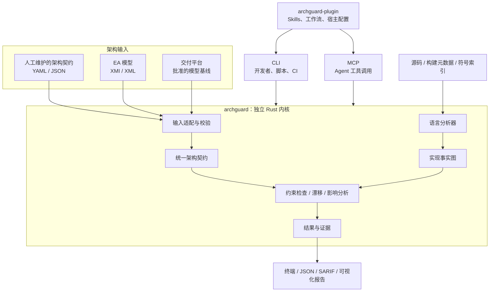
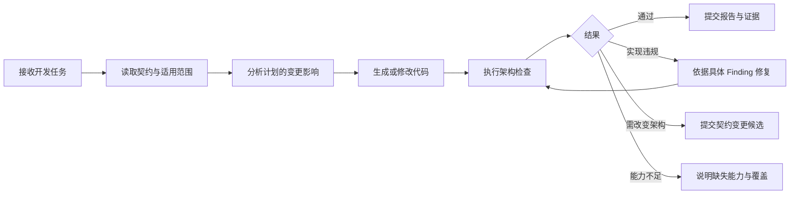

# ArchGuard 内核、CLI、MCP 与架构契约设计

架构守护通过 **CLI、MCP 和模型／契约文件**实现，三者承担不同职责：

> **ArchGuard 提供无界面的架构验证内核；CLI 和 MCP 提供调用入口；文件承载架构契约与模型快照；archguard-plugin 帮助 AI 在开发流程中使用这些能力。**

交付平台或 EA 用按钮、编辑器和图形界面组织操作，ArchGuard 将对应操作暴露为可编程能力。它既能独立用于普通 Git 仓库，也能被交付平台集成。

本文记录目标设计。设计时的实现基线为 Cargo 依赖检查 CLI；后续演进见 [架构检查闭环](archguard-architecture-check-loop.md) 与 [技能整合方案](matt-pocock-skills-integration.md)。下文拟议格式和命令不表示已实现，实际入口以当前工具帮助为准。

## 1．整体上分成四层



关键是 **CLI、MCP 调用同一套内核**。不能 CLI 判断通过，MCP 又通过提示词得出另一种结果。

XML 是输入输出格式之一，不是运行入口，也不适合承担全部内部协议。

## 2．把软件里的功能转化为明确操作

| 交付平台／EA 中的操作 | ArchGuard 对应能力 | 谁负责 |
|---|---|---|
| 定义模块、接口和依赖规则 | 编写或导入 Architecture Contract | 契约文件、Model Engine 或外部建模工具 |
| 导入模型 | 解析 XMI／平台快照，生成候选契约 | 输入适配器 |
| 查看代码结构 | 扫描模块、类型、符号与关系 | 语言分析器 |
| 检查架构 | 对照契约验证实现 | ArchGuard 内核 |
| 比较设计和实现 | 输出缺失、违规、未批准变更和未知项 | 漂移分析 |
| 查看变更影响 | 查找消费者、依赖方与测试义务 | 影响分析 |
| 查看问题详情 | 展示规则来源、代码位置、原因 | CLI／MCP／报告 |
| 批准架构变化 | 评审候选契约并形成新基线 | Git PR 或交付平台 |

这里有一个重要边界：**ArchGuard 应支持独立编写约束，但完整的 UML 编辑、模型事务和图形布局继续由建模工具负责。**

没有交付平台、没有 EA，开发者仍然可以写一个契约文件，然后运行检查。

## 3．文件应该怎么设计

格式选择：**YAML 面向人，JSON 面向程序，XMI／XML 面向外部模型交换**。

| 格式 | 用途 |
|---|---|
| YAML | 人工维护架构契约、项目配置、规则包引用 |
| JSON | 标准化模型快照、事实、检查报告、MCP 数据 |
| XMI／XML | 导入或导出 EA 支持的模型交换数据 |
| SARIF | 将问题接入代码扫描与评审界面 |
| Mermaid／HTML | 展示依赖、违规路径和影响范围 |

不需要每个项目都维护所有格式。最小项目只需要配置和契约：

```text
项目根目录/
├── archguard.yaml
├── architecture/
│   └── contract.yaml
└── src/
```

扫描事实和报告属于生成产物，可以输出到被 Git 忽略的目录。

例如，未来可以提供这样的高层契约——**这是拟议格式，不是当前 v1alpha1 已支持的语法**：

```yaml
apiVersion: archguard.dev/v1alpha2
kind: ArchitectureContract

metadata:
  id: order-service-architecture
  revision: "3"

spec:
  modules:
    - id: order.domain
      selector:
        language: java
        package: "com.example.order.domain.."

    - id: order.infrastructure
      selector:
        language: java
        package: "com.example.order.infrastructure.."

  rules:
    - id: ORDER-ARCH-001
      type: forbidden_dependency
      from: order.domain
      to: order.infrastructure
      enforcement: enforce

    - id: ORDER-ARCH-002
      type: required_interface_implementation
      interface: "com.example.order.domain.OrderRepository"
      implementationScope: order.infrastructure
      enforcement: enforce
```

内核先校验模块选择器、规则语义和分析器能力，再执行检查。模块没找到、语言不支持，都必须明确报告。

高层领域规则由 ArchGuard 解释，通用结果聚合和证据机制继续复用 GuardEngine。

## 4．CLI 应该围绕实际工作流程设计

CLI 按工作流程分组，避免让用户面对大量互不相关的命令。

| 阶段 | 拟议命令 | 作用 |
|---|---|---|
| 准备 | `archguard doctor` | 检查语言、构建系统、可用分析器和能力缺口 |
| 准备 | `archguard init` | 显式生成配置和契约模板 |
| 契约 | `archguard contract validate` | 校验契约结构、引用和规则适用性 |
| 契约 | `archguard contract import` | 从 XMI 或平台快照生成候选契约 |
| 检查 | `archguard scan` | 提取实现事实，供诊断和复用 |
| 检查 | `archguard check` | 一步完成采集、检查和报告 |
| 分析 | `archguard diff` | 比较两个代码快照的架构变化 |
| 分析 | `archguard drift` | 比较批准契约与当前实现 |
| 分析 | `archguard impact` | 分析指定模型或符号的影响范围 |
| 分析 | `archguard explain` | 解释某条规则或检查结果 |

普通用户主要使用 **`doctor → contract validate → check`**。`scan` 等命令服务于高级分析，不强迫用户手动拼流水线。

当前已有的命令可以保持兼容：

```powershell
archguard check `
  --project . `
  --contract architecture/contract.yaml `
  --report artifacts/architecture-report.json
```

未来导入 EA 模型的使用方式可以是：

```powershell
archguard contract import `
  --format xmi `
  --input architecture/export.xmi `
  --mapping architecture/ea-mapping.yaml `
  --output architecture/candidate.yaml
```

**导入结果是待评审候选。** 导入器需要报告哪些元素已映射、哪些关系无法识别、哪些信息丢失。不能把无法理解的 XML 元素静默丢弃后声明完整。

而且，模型里的普通依赖线不能自动解释成“其他依赖全部禁止”；这种强制语义应通过明确的模型标记或映射配置表达。

## 5．MCP 暴露同样的能力，但面向结构化调用

CLI 适合人和 CI，MCP 适合 Agent。建议首批只提供少量明确工具：

```text
archguard_get_capabilities
archguard_validate_contract
archguard_check
archguard_diff
archguard_impact
archguard_explain
```

例如 Agent 调用 `archguard_check`，参数直接包含项目、契约版本和候选版本；返回结构化结果：

```json
{
  "decision": "BLOCK",
  "findings": [
    {
      "ruleId": "ORDER-ARCH-001",
      "status": "FAIL",
      "message": "领域模块依赖了基础设施模块",
      "source": {
        "file": "src/main/java/com/example/order/domain/Order.java",
        "line": 18
      },
      "expected": "通过领域端口访问外部实现"
    }
  ],
  "coverage": {
    "complete": true,
    "unknowns": []
  }
}
```

实际报告还应带输入摘要、分析器版本和契约来源。

MCP 服务应直接调用 Rust 内核；对于耗时扫描，提供任务 ID、状态查询和取消能力。这样不会让一次工具调用无限等待。

## 6．插件的价值是让 Agent 按正确顺序使用工具

`archguard-plugin` 不应只是给 `archguard check` 换个名字。它负责把架构约束接入开发过程：



插件可以包含：

| 内容 | 作用 |
|---|---|
| Skills | 指导读取约束、分析影响、修复问题、提交架构变更 |
| MCP 配置 | 连接本地或平台提供的 ArchGuard 服务 |
| CLI 适配 | 在没有 MCP 的宿主中运行同样的检查 |
| Hooks | 在适当时机提醒或触发检查 |
| 规则模板 | 提供分层、DDD、模块边界等起始模板 |
| 结果呈现 | 将 Finding 转换为代码定位、解释和可审查建议 |

插件必须认识到两种不同结果：代码违反已有契约时修复代码；需求确实需要改变架构时生成变更候选并提交评审。不能为让检查通过而自行放宽规则。

## 7．三种部署方式使用同一套核心

| 使用场景 | 组合方式 |
|---|---|
| 普通代码仓库 | 契约 YAML + CLI + Git PR + CI |
| AI 编程工具 | archguard-plugin + MCP／CLI + 本地契约 |
| 智能交付平台 | Model Baseline 适配器 + ArchGuard 服务 + 平台评审与证据 |

EA 则作为模型输入端：**EA 导出 → 适配与语义映射 → 候选契约 → 评审 → ArchGuard 检查代码**。ArchGuard 不依赖 EA 才能运行。

第一阶段优先实现 **“契约文件 + CLI 检查 + JSON 报告 + 薄 MCP + 插件工作流”**。随后增加平台基线适配和 XMI 导入。这样每一步都有独立使用价值，也能逐步接入交付平台，而不必等整个建模系统完成。
