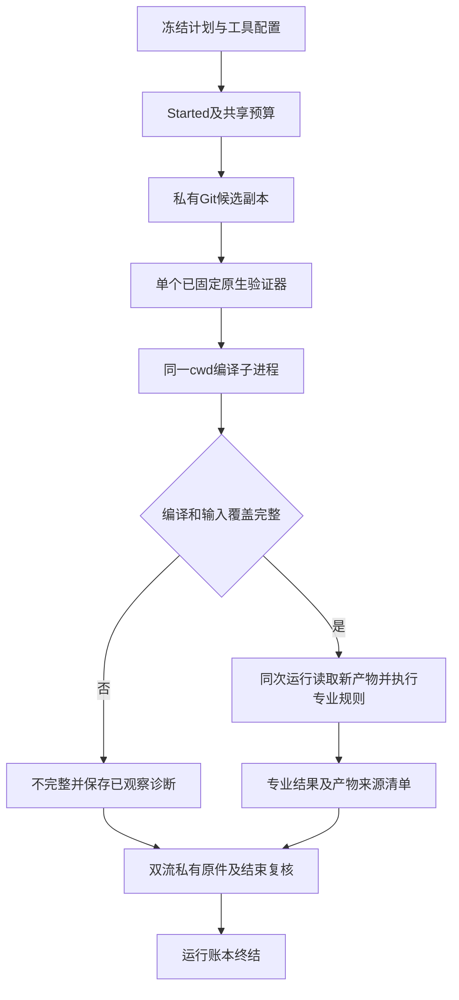

# 原生验证器的多阶段运行约束

本文说明现有K03/K06机制的产品接线边界，供EG-A01等专业适配器使用，不建立第二份任务或验收标准。ArchGuard规则、Java/Maven解析及质量判定留在ArchGuard；GuardCore只管理输入、进程、预算、原件和运行顺序。

## 同次运行中的编译与检查

`Runtime::execute_v2`每次调用创建自己的私有候选副本，结束核验后释放。两次调用没有共享cwd或构建输出的契约，不能把编译与ArchUnit拆成两个独立调用后假定第一次target仍可供第二次使用。

Java适配器可以以固定Java可执行文件作为根进程，在同一私有cwd使用字面argv启动已固定Maven，再导入本次编译产物。Windows不能把mvn.cmd绕作原生exe；需明确Java启动Maven的入口、classpath、maven.home与参数。Maven子孙仍受同一个Runner Job、绝对截止、取消和聚合输出预算约束。适配器不得另起脱管后台服务或以shell重写这些限制。

根Java制品摘要不足以证明全部工具链：适配器JAR、ArchUnit及传递库、Maven启动和插件组件均须由产品配置固定并复核。工具缺失或制品身份不符应返回缺口；不能静默换版本、安装CLI或以旧class替代编译成功。如何解析POM、识别项目类型和解释ArchUnit结果属于ArchGuard，不向GuardCore添加相关规则。

## 原输入与新增构建输出

物化结束复验核对全部冻结原输入。允许新增输出不等于批准这些输出成为输入，也不证明编译覆盖完整。产品需要记录本次编译状态、预期项目类集合、实际导入类集合、源码和产物摘要，以及无法解析的项目依赖。空集合、缺类、损坏class和不完整导入不能凭无违规判为通过。

Worktree捕获目前包含ignored文件。若原项目已有target并被纳入冻结清单，在副本内执行clean删除它们也会导致原输入复验失败；不得为让构建通过而偷偷删除清单条目。干净Commit/Index候选可从对应Git树编译。需要支持已有产物的Worktree时，应明确使用独立新增输出位置并验证实际Maven插件遵守该位置，否则报告能力不足。不得清理原工作树来绕过这个问题。

`verify`必须在当前候选重新执行完整验证流水线，比较绑定的规则、工具、源码和产物来源；旧报告、已有target目录或相同文件名不构成新鲜证明。修复只改变候选代码，不自动放宽批准规则。

## 信任与恢复

单次执行观察固定local_unverified。运行退出0仍不能自动升级为质量通过；专业适配器另外解析确定违规与覆盖程度，批准与最终动作由后续可信控制端处理。Job管理不等于文件、网络或凭据沙箱。原生程序自行访问外部路径的风险不能由私有cwd存在消除。

调用future丢弃或宿主崩溃时，不承诺执行异步结束核验或数据库终结。恢复前由控制端确认旧树终止/隔离，运行账本显式recover并保留旧原件；不复用未确认的旧产物，也不重放已消费operation。
