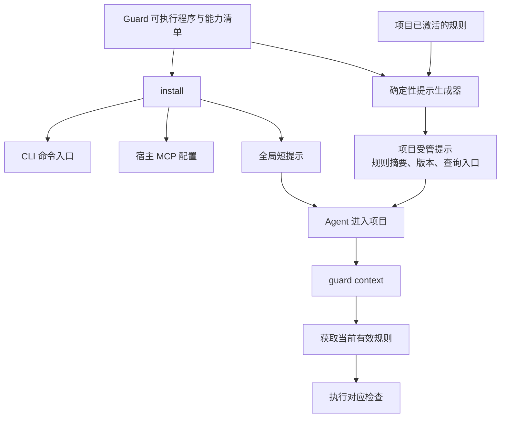

# 六个 Guard 的安装与智能体提示注入设计

**工具安装后，必须让智能体知道“什么时候用、先调用什么、按哪个项目规则执行、结果如何处理”。** 这应该成为六个 Guard 共同具备的正式能力。

CodeGraph 安装器按宿主写入 MCP 配置和短提示块，并区分用户级、项目级安装。CodeGuard 也已有项目 `AGENTS.md` 受管摘要，可以在其基础上扩展。

以下为统一命令和安装契约的目标设计；设计时基线与后续实现状态须区分。接入实现见 [安装使用说明](agent-installation.md)，架构能力见 [架构检查闭环](archguard-architecture-check-loop.md)。拟议命令以当前 CLI 帮助和实际能力清单为准。

## 1．统一安装体验，区分安装、接入和项目启用

六个工具都应具备这组管理命令：

| 命令 | 职责 |
|---|---|
| `<guard> install` | 安装／登记命令入口，接入指定智能体，注入受管提示 |
| `<guard> uninstall` | 移除本工具拥有的宿主配置和提示 |
| `<guard> doctor` | 检查 CLI、宿主配置、MCP、项目规则与提示是否一致 |
| `<guard> context` | 返回当前项目的有效规则、版本、适用范围与下一步 |
| `<guard> instructions render` | 只生成提示内容，供预览或外部集成 |
| `<guard> instructions sync` | 根据有效配置更新受管提示 |
| `<guard> init` | 显式启用项目规则；沿用各工具自己的初始化语义 |

这里 `<guard>` 表示六个工具中的任意一个。管理命令统一，专业命令保留各自职责。

例如，拟议用法：

```powershell
gitguard install `
  --agents codex,claude,gemini `
  --scope project `
  --project E:\workspaces\my-project `
  --bin-dir D:\tools\partme\bin
```

这次操作应完成：

1. 核实当前程序版本，将可执行入口安装到指定位置。
2. 根据宿主适配器配置调用入口。
3. 写入对应的受管提示块。
4. 输出实际修改的文件、安装结果和需要重新加载的宿主。

`install` 不自动替项目选择 GitFlow，也不自动创建开发分支。项目启用和工作流选择属于 `init` 或已有的策略激活流程。

首次获取可执行程序仍由发布包或引导安装器完成；已有程序之后才能执行自己的 `install`。两步可以由安装包串联。

## 2．提示采用“全局短指引＋项目规则摘要”

这比给所有项目注入同一份长规范更合适。



**全局提示**只回答“何时发现和调用本工具”，不能包含某个仓库专属的分支、目录或验收标准。

**项目提示**可以包含具体规则，但必须由已激活配置生成，并带上规则来源、版本和摘要。它是规则的可读投影，CLI 判定仍读取结构化规则。

这样，切换工作流时，只需更新规则并同步提示，不会留下两套互相冲突的规范。

## 3．GitGuard 按实际工作流生成提示

下述示例适合一种组织自定义工作流，不能直接作为所有项目的默认 GitFlow。

现有 `gitflow-plugin` 已有八种模板，应优先复用其规则语义。例如：

| 项目工作流 | 注入的主要分支关系 |
|---|---|
| Classic GitFlow | feature 从 develop 创建并合回 develop；release、hotfix 按配置回灌 |
| GitHub Flow | 短期 feature 分支通过评审合入 main |
| Trunk-based | 按项目配置使用短期分支和主干集成约束 |
| GitLab environment 模板 | 按实际配置逐环境传播 |
| 组织自定义流程 | `feature/* → test/* → main` |

不能只根据 profile 名字拼一段固定文案。应从**实际生效的分支角色、命名模式、创建来源和允许合并边**生成说明。

针对自定义流程示例，项目提示可以生成如下内容；其中的规则必须先在项目配置中明确：

```markdown
<!-- GITGUARD_START -->
## GitGuard

本项目使用已激活的 feature-test-main 工作流。
操作 Git 前，先运行 `gitguard context --project .` 获取当前规则。

### 分支命名
- 主分支：main。
- 需求分支：feature/REQ-需求编号-开发者-功能。
- 示例：feature/REQ-20261014-wandl-member。
- 测试分支：test/YYYYMMDD，例如 test/20261016。

### 创建与合并
- 需求开发在对应 feature 分支完成。
- 普通需求按 feature/* → test/* → main 集成。
- 分支创建来源、回灌和例外以当前生效规则为准。
- 创建、切换、提交、推送和合并前执行相应 GitGuard 检查。
- 检查允许不代替用户授权或受保护分支审批。

规则来源、修订和摘要由安装器填写。
<!-- GITGUARD_END -->
```

这里还有两个需要规则明确的点：

- `main`、`master` 是实际分支名称，不应默认都存在；示例中的 `marster` 不应直接写入模板。
- `test/YYYYMMDD` 除了格式，还应校验日期有效性；`feature` 从哪里创建也必须单独定义，不能从合并方向推断。

全局 GitGuard 提示则保持简短：

```markdown
<!-- GITGUARD_START -->
## GitGuard

在 Git 工作树中执行分支、提交、同步或合并操作前，获取项目当前生效的 GitGuard 规则。
优先使用已提供的 MCP 工具；无 MCP 时使用 CLI。
不要假定项目采用某种 GitFlow，也不要自行初始化、切换工作流或放宽规则。
配置缺失或规则冲突时，说明未验证原因；需要门禁的操作不得按通过处理。
<!-- GITGUARD_END -->
```

## 4．其余五个 Guard 也应有自己的触发提示

下面是建议的提示语义。实际安装时，生成器只填入**当前版本确实支持的命令和 MCP 工具名**。

| 工具 | 触发时机 | 提示的核心要求 |
|---|---|---|
| SpecGuard | 开始需求、设计或修改验收条件前 | 找到唯一规格事实源，读取批准基线，检查追踪关系 |
| ArchGuard | 改模块边界、公共接口、依赖或领域结构前后 | 读取架构契约，分析影响，修改后检查一致性 |
| CodeGuard | 修改代码后、宣称修复完成前 | 使用项目配置和原生检查器，按真实任务复检 |
| TestGuard | 制定测试、执行验证、宣称完成前 | 固定测试义务，核对实际执行与覆盖缺口 |
| FlowGuard | 开始阶段、交接或交付前 | 读取当前阶段和缺失证据，验证下一动作资格 |

对应短提示可以这样设计。

```markdown
<!-- SPECGUARD_START -->
## SpecGuard

开始需求、设计或实现前，读取项目声明的规格事实源和批准基线。
沿用已有 OpenSpec、Spec Kit 或项目规格，不重复创建第二套需求。
修改验收标准、非目标或核心需求时，提交规格变更并检查影响。
缺失追踪、解析失败和未批准变更不能作为规格已满足的证据。
<!-- SPECGUARD_END -->
```

```markdown
<!-- ARCHGUARD_START -->
## ArchGuard

修改模块依赖、领域边界、公共类型或接口前，读取当前架构契约并检查影响范围。
修改后运行适用的架构检查，保留规则来源、代码位置和候选版本。
只使用分析器实际支持的能力；覆盖不足不得解释为没有违规。
需要改变架构时提交契约变更，不为通过检查而自行放宽规则。
<!-- ARCHGUARD_END -->
```

```markdown
<!-- CODEGUARD_START -->
## CodeGuard

修改代码后，按项目既有配置运行适用的原生检查。
读取完整结果和下一步；区分源码问题、环境阻塞和未完成检查。
修复后使用对应检查器复检，保留稳定任务与尝试记录。
不得通过关闭规则、扩大白名单或隐藏失败来宣称修复完成。
<!-- CODEGUARD_END -->
```

```markdown
<!-- TESTGUARD_START -->
## TestGuard

执行验证前，确认批准的测试义务、范围和环境要求。
记录实际运行的测试、失败、跳过、取消、超时与未覆盖项。
零测试、缺失报告或部分执行不能作为测试通过。
完成声明必须引用与当前候选匹配的真实执行证据。
<!-- TESTGUARD_END -->
```

```markdown
<!-- FLOWGUARD_START -->
## FlowGuard

开始阶段、任务交接和交付前，读取项目当前流程与下一动作条件。
沿用现有阶段定义、文档位置和规格事实源。
技术检查由对应专业 Guard 提供证据，阶段审批使用有效授权。
条件不满足时继续允许修复、补充材料和重新验证，不自行批准流程例外。
<!-- FLOWGUARD_END -->
```

这些基础提示负责引导行为；项目摘要再补充具体语言、架构契约、测试矩阵、阶段图等内容。六段都应保持短，详细规则按需通过 `context` 和专业命令读取。

## 5．安装器应共用机制，规则生成各自负责

建议提供一个独立的共享安装库，供六个 CLI 使用：

```text
共享安装能力
├── 可执行入口安装与版本核验
├── 宿主发现与配置适配
├── 受管区块更新
├── 安装记录与冲突检测
├── instructions render / sync
└── uninstall / doctor

各 Guard 自有内容
├── 实际能力清单
├── 触发条件与基础提示
├── 项目配置解析器
└── 项目规则摘要生成器
```

不建议把宿主文件修改逻辑塞进 GuardEngine 的规则判定内核。

安装行为至少满足：

- 重复安装不产生重复提示或重复 MCP 配置。
- 只更新自己的标记块，保留人工内容和其他 Guard 的配置。
- 人工修改过受管内容时报告冲突，提供差异后再协调。
- 支持 `--dry-run`，列出将修改的路径和内容。
- 卸载只移除安装记录确认拥有的内容，不删除项目规则、报告和证据。
- 多个 Guard 同时更新同一个文件时，检测并发修改，避免相互覆盖。
- CLI 路径、MCP 服务和提示中的版本不一致时，`doctor` 能指出。
- 静态配置写入成功与宿主实际加载成功分别报告。

CodeGuard 已有的 `CODEGUARD:BEGIN project-context` 区块应保留兼容，不应直接替换成新标记而丢失已有项目摘要。

## 6．设计时能力基线与接入路线

| 工具 | 设计时状态 | 计划接入方式 |
|---|---|---|
| ArchGuard | 已有 Cargo 检查 CLI | 增加安装与提示，明确当前只覆盖 Cargo 成员直接依赖 |
| CodeGuard | 已有 CLI、工作台和项目提示 | 扩展到多宿主安装，复用现有受管更新机制 |
| GitGuard | 新 CLI 尚未实现 | 复用 GitFlow 现有规则和生效配置，再接入新入口 |
| FlowGuard | 新运行时尚未实现 | 延续已有插件阶段语义和路径 |
| SpecGuard | 设计阶段 | 与首个可执行检查能力一起交付安装入口 |
| TestGuard | 设计阶段 | 与真实测试执行、报告验证能力一起交付 |

**应把“安装后自动获得正确使用指引”列为六个 Guard 的共同验收项。** CLI 提供真实能力，MCP 提供结构化调用，插件提供工作流，受管提示保证主 Agent、子 Agent 和无 MCP 的调用环境都能发现并正确使用它们；具体规范则始终来自项目当前生效的配置。
