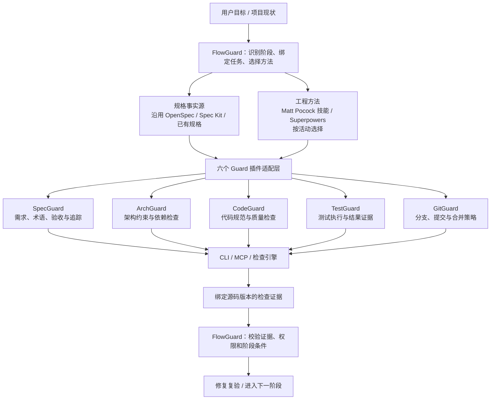
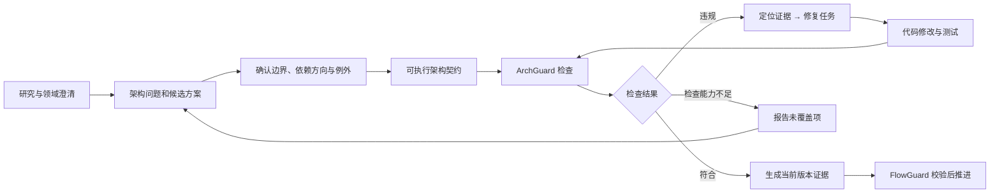

# Matt Pocock 技能与六个 Guard 插件整合方案

27 项技能的能力可纳入 Guard 插件体系。整合需要经过职责拆分、宿主适配和运行验证。

研究范围包括技能介绍页、上游技能源码及本地 Guard 工具和插件。研究基线固定为上游 `1.3.1`、提交 `49dd158d1076`，其发布清单正好包含这 27 项技能。上游采用 MIT 许可证，复用时应保留版权和许可声明，以及相关文件中的第三方署名。[上游发布清单](https://github.com/mattpocock/skills/blob/49dd158d1076134a641b33efb035946536778336/.claude-plugin/plugin.json)、[许可证](https://github.com/mattpocock/skills/blob/49dd158d1076134a641b33efb035946536778336/LICENSE)

整合方案：**共享维护这套工程方法，由六个 Guard 插件分别承接职责，FlowGuard 负责衔接已有规格体系和执行门禁。优先贯通 ArchGuard 的“发现问题—形成约束—检查—修复—复验”闭环。**

## 一、这套技能最值得补进来的是什么

它覆盖了Guard 工具链中容易断开的几个环节：

- 把模糊想法追问成可以决策的问题。
- 在形成规格之前，通过研究、原型和领域术语消除不确定性。
- 把规格拆成能够独立验证、具有依赖关系的开发任务。
- 在新会话中可靠接续任务。
- 将开发过程暴露的问题沉淀为工程改进。

这些能力与已有的确定性检查相互补充。例如，`improve-codebase-architecture` 可以帮助发现模块耦合和测试困难，但它的评审结论还需要转成项目认可的架构约束，ArchGuard 才能自动执行。[架构改进技能](https://www.aihero.dev/skills-improve-codebase-architecture)

交付平台、EA 软件和智能体插件共用以下能力链。平台提供页面，插件提供交互指导，CLI/MCP 提供相同的检查入口。



这是建议的目标结构。当前各个 Rust CLI 的能力成熟度不同，不能把这张图理解为已经全部实现。

## 二、27 项技能如何分配

表中的“归属”是建议的维护责任；一个技能可以调用其他 Guard，但不应在多个插件里各自维护一份不同的业务规则。

| 技能 | 建议归属 | 整合方式 |
|---|---|---|
| `setup-matt-pocock-skills` | FlowGuard／安装公共层 | 转为项目能力发现与配置适配；补充 Maven、Cargo 项目识别 |
| `ask-matt` | FlowGuard | 转为基于实际已安装能力的路由，推荐适合当前阶段的方法 |
| `grill-with-docs` | SpecGuard，协同 ArchGuard | 需求追问与领域建模联动，把确认结果写回已有规格和术语表 |
| `to-spec` | SpecGuard | 输出到项目当前规格体系，保留需求、非目标和验收条件 |
| `to-tickets` | FlowGuard＋SpecGuard | 把需求拆为可验证的纵向任务，维护依赖与需求关联 |
| `implement` | FlowGuard | 编排单任务实施，调用架构、代码和测试检查 |
| `code-review` | CodeGuard／现有 CodeReview 能力 | 分别审查代码标准与规格符合性，保留两个维度的结论 |
| `retro` | FlowGuard | 输出工程改进候选，再分派给相关 Guard |
| `wayfinder` | FlowGuard＋SpecGuard | 管理尚未解决的决策和研究依赖，与开发任务图分开 |
| `prototype` | ArchGuard，协同 TestGuard | 为架构或交互方案提供验证原型，记录结论和适用范围 |
| `research` | 公共方法层，由 FlowGuard 调用 | 保存有来源、有时间和适用范围的研究证据 |
| `improve-codebase-architecture` | ArchGuard | 发现架构问题、提出候选方案，形成后续约束和改造任务 |
| `diagnosing-bugs` | CodeGuard＋TestGuard | 建立复现、检验假设、修复并执行回归验证 |
| `triage` | FlowGuard＋SpecGuard | 分类需求与缺陷、核实问题、形成可执行任务说明 |
| `wizard` | FlowGuard | 为必须由人完成的配置步骤生成向导，适配操作系统 |
| `implement-spec` | FlowGuard | 承接任务图执行；多 Agent、工作树和合并交给真实运行时管理 |
| `grill-me` | SpecGuard | 提供轻量澄清入口，不强制完整规格流程 |
| `handoff` | FlowGuard | 生成可恢复的交接记录，引用规格、源码版本和验证结果 |
| `to-questionnaire` | SpecGuard | 生成面向业务、架构师或使用者的待确认问题 |
| `teach` | 可选辅助技能包 | 用于培训和项目知识学习，不进入默认检查门禁 |
| `wait-what` | 公共交互层 | 简化解释，保留项目术语，支持中文表达 |
| `writing-for-agents` | 插件开发公共层 | 指导提示、技能和交接材料的结构，减少重复上下文 |
| `pr` | GitGuard | 组织变更说明、验证证据及合并风险，遵循仓库 PR 模板 |
| `codebase-design` | ArchGuard | 提供模块设计评审方法，作为建议依据 |
| `domain-modeling` | SpecGuard＋ArchGuard | SpecGuard 维护术语事实源，ArchGuard 将领域边界映射到代码结构 |
| `grilling` | 公共方法层，SpecGuard 主用 | 统一问题依赖、推荐答案和已确认决策的处理方式 |
| `tdd` | TestGuard，FlowGuard 调用 | 指导行为测试和红绿循环，由执行结果提供验证证据 |

上游本身也有明确的依赖关系。例如，`grill-with-docs` 的主体就是加载 `grilling` 和 `domain-modeling`；只复制入口文件会丢失实际能力。需要连同依赖技能、参考文档和模板一起打包。[主流程介绍](https://www.aihero.dev/skills-grill-with-docs)、[完整技能目录](https://www.aihero.dev/skills)

## 三、必须处理的几个实质冲突

### 1. 规格只能有一个权威来源。

上游 `to-spec` 会把规格发布到配置的任务系统，`to-tickets` 继续生成关联任务。直接叠加到现有 OpenSpec 或 Spec Kit 上，容易出现“本地规格一份、Issue 正文又一份”，随后各自发生变化。[to-spec](https://www.aihero.dev/skills-to-spec)、[to-tickets](https://www.aihero.dev/skills-to-tickets)

规格适配遵循以下规则：

- OpenSpec 项目：更新对应 change 的规格和任务。
- Spec Kit 项目：沿用已有 feature 产物。
- 已有其他规格：使用明确配置的映射。
- Issue、工单、平台页面：作为关联记录或同步视图，注明来源与修订版本。

`domain-modeling` 的术语表也应保持专门用途，不能逐渐变成另一份混杂需求、架构和实现细节的规格。

### 2. 方法可以复用，执行权限必须由项目和宿主管理。

上游几个技能有实际写入行为：

| 技能 | 上游行为 | Guard 适配要求 |
|---|---|---|
| `implement` | 完成后提交代码 | 受当前提交授权和 GitGuard 策略约束 |
| `implement-spec` | 创建分支、工作树、调度子 Agent、合并，部分场景创建 PR | 受宿主能力、项目授权和合并门禁约束 |
| `wayfinder` | 创建和关闭任务，研究分支可能推送远端 | 将研究、任务写入和 Git 操作分别处理 |
| `triage` | 评论、修改标签、关闭 Issue | 区分只读分类和已授权的外部写入 |
| `setup-matt-pocock-skills` | 修改项目指导文件，部分配置创建远端标签 | 安装、初始化、规则注入分别管理 |

这些不是抽象风险，而是上游定义中的具体行为。[implement](https://www.aihero.dev/skills-implement)、[implement-spec](https://www.aihero.dev/skills-implement-spec)、[wayfinder](https://www.aihero.dev/skills-wayfinder)、[triage](https://www.aihero.dev/skills-triage)

尤其不能把任务标签 `ready-for-agent`，或者 Agent 自己写入文档的一段“可以执行”，当作用户授权。

### 3. Superpowers 与这套技能要按活动选择。

不能在同一阶段同时加载两套相互冲突的执行要求。

例如，上游 `tdd` 明确把重构放到后续代码审查阶段，不纳入自己的红绿循环；它还要求确认测试切入点。整合时应选择当前项目采用的方法，并复用已经确认的测试方案，避免反复询问用户。[TDD 技能](https://www.aihero.dev/skills-tdd)

建议 FlowGuard 分别记录：

- 规格由什么体系管理。
- 澄清、设计、实施、评审分别采用什么方法。
- 本次采用的版本。
- 当前活动的完成条件。

这样可以选用 Matt 的需求澄清、项目已有的 TDD 方法和现有 CodeReview，而不用整体切换流程。

### 4. 代码审查必须覆盖实际修改。

上游 `code-review` 主要围绕固定基线与 `HEAD` 的提交差异工作。照搬时，工作区未提交修改、暂存修改和未跟踪文件可能不在审查范围内。[代码审查源码](https://github.com/mattpocock/skills/blob/49dd158d1076134a641b33efb035946536778336/skills/engineering/code-review/SKILL.md)

Guard 体系的适配器必须明确审查范围，并让证据绑定对应快照。不能因为提交差异为空，就认为当前工作区已经审查通过。

### 5. 包结构和宿主能力并不天然兼容。

上游采用 Claude 插件清单和分组技能目录；Guard 体系的可移植插件使用根 `plugin.json`、`skills/<名称>/SKILL.md`、根 `mcp.json`。需要转换包结构、维护引用路径，并为技能加载和宿主专有元数据提供适配。[Agent Plugins 规范](https://agent-plugins.org/specification)

还要处理：

- 本地已存在同名 `codebase-design`，需要明确来源和版本。
- `wizard` 生成的是 Bash 向导，Windows 原生 PowerShell 环境需要对应实现或明确前置条件。
- `handoff` 等技能使用临时目录，应遵循 D/E 盘开发约束。
- 多 Agent 能力不可用或未授权时，需要串行执行路径。
- 手动调用技能的限制不能被统一路由器擅自取消。[Wizard](https://www.aihero.dev/skills-wizard)、[Handoff](https://www.aihero.dev/skills-handoff)

## 四、ArchGuard 应该优先形成怎样的闭环

优先整合以下五项：

`domain-modeling`、`grill-with-docs`、`codebase-design`、`improve-codebase-architecture`、`research`。

它们共同解决“架构约束从哪里来、为什么成立、怎样落到项目代码”这几个问题。



以 Java/Maven 项目为例：

1. **领域建模**确认订单域、支付域等业务边界及统一术语。
2. **架构评审**发现订单领域模块直接依赖支付基础设施模块。
3. **项目决策**明确允许的通信接口、禁止的依赖和必要例外。
4. **架构契约**将这些决定映射为具体模块和依赖规则。
5. **检查引擎**输出违规边、来源文件、规则编号及修复依据。
6. **修复后复验**重新检查源码，并验证关联测试。
7. **流程门禁**核对证据是否对应当前源码和当前规则版本。

这里要保留三个不同状态：

- **建议**：例如模块接口过宽，需要架构师判断。
- **约束**：项目已经确认，且定义明确。
- **检查结果**：引擎实际执行后得到的事实。

“模块不够深”“设计不够优雅”适合评审，不能直接变成硬性失败。反过来，明确禁止的模块依赖，也不能被一句“总体设计合理”抵消。

当前 ArchGuard 已有 Maven/Cargo 架构检查基础和 MCP 检查、解释、验证入口，可以承接这条路径；Java 源码级引用、完整 Maven 有效模型等覆盖仍需要继续补充。遇到不支持的约束应报告未覆盖，不能生成通过证据。

## 五、安装和提示注入也应随项目变化

`install` 注入**短小的项目操作约定**，完整方法按需加载。

以下为 ArchGuard 提示注入的设计示例：

```markdown
<!-- ARCHGUARD_START -->
## ArchGuard

修改模块结构、依赖关系或跨层调用前：
- 读取本项目生效的架构契约、领域术语和 ADR。
- 获取 ArchGuard 当前上下文，确认适用规则及检查覆盖范围。
- 存在架构歧义时，使用已安装的领域建模或架构澄清技能。
- 修改后执行架构检查；存在违规时，根据证据修复并重新验证。
- 未覆盖的规则必须明确报告，不能视为检查通过。
- 架构建议须经项目决策确认后，才能转为强制约束。
<!-- ARCHGUARD_END -->
```

其他 Guard 同样根据当前配置生成内容。GitGuard 应反映实际 Git 工作流；SpecGuard 应指向实际规格来源；FlowGuard 应说明当前阶段和证据要求。

提示注入负责提醒和引导。强制执行仍应依靠可用的工具检查、宿主 Hook 或 CI 门禁。

## 六、落地时复用现有基础，避免再建一套平行体系

本地已有两个特别需要遵循的基础：

- [FlowGuard 插件](E:/workspaces/workspace-agent-skills/full-stack-plugins-repositories/flowguard-plugin/README.md) 已承担规格发现、任务绑定、证据时效和门禁。应在这里增加方法适配与路由，并与 Rust CLI 对齐。
- [CodeGuard 插件规范](E:/workspaces/workspace-agent-skills/full-stack-plugins-repositories/codeguard-plugin/AGENTS.md) 已规定外部技能来源、锁文件和 vendor 流程。不能直接修改受管理的技能副本。

共享方法建议只维护一个源码来源，锁定上游提交、适配补丁和依赖清单；构建时为各插件生成完整的依赖包。不能假设所有客户端都支持跨插件直接调用同名技能。

推荐分三批推进：

| 批次 | 实施内容 | 验收重点 |
|---|---|---|
| 第一批 | 公共依赖管理、规格适配、ArchGuard 五项方法接入 | 架构决策能形成契约；真实违规能检出；修复后重新验证 |
| 第二批 | 规格拆解、单任务实施、TDD、代码审查、交接 | 需求到任务再到测试可追踪；未提交修改被覆盖；旧证据不能复用 |
| 第三批 | 任务图执行、分诊、研究编排、原型、向导、复盘 | 权限、并发冲突、失败恢复、Windows 适配和外部写入行为经过验证 |

`teach`、`wait-what` 等辅助能力可以完整收录为可选项，不必成为每个项目的强制开发步骤。


## 验证边界

本方案为技能能力整合设计。客户端加载、MCP 调用及端到端工作流的兼容性需要逐项取得运行证据；不能将能力映射或包结构转换视为完整兼容证明。

